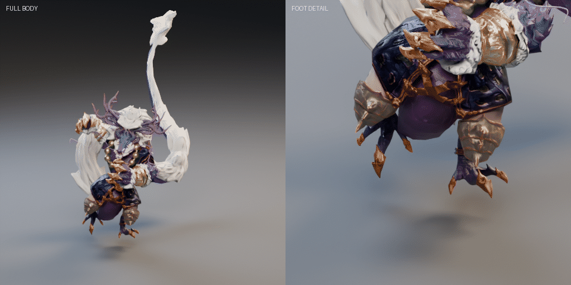

# Dragon Man · 游戏用龙人武士角色 / Game-Ready Dragon-Man Character

基于 CC-BY 4.0 素材二次制作的游戏可用龙人武士（Q 版），含 32 骨绑骨与无缝待机动画，提供 Blender 源文件与 glTF 交付件。

## 文件清单 Contents

| 路径 | 说明 |
|---|---|
| `dragon-men-gameready/DragonMan_rigged.blend` | Blender 5.2 LTS 源文件：32 骨骨架 + PBR 材质 + Idle_Lively 动作 |
| `dragon-men-gameready/DragonMan_rigged.glb` | glTF 二进制：网格 + 骨架（T-Pose rest，供引擎对接绑骨） |
| `dragon-men-gameready/DragonMan_animated.glb` | glTF 二进制：含待机动画，可直接进引擎播放 |
| `dragon-men-gameready/Idle_Lively_preview.gif` | 待机动画预览（见上方） |
| `dragon-men-gameready/rig_final_rest.png` | 绑定最终 rest 姿态参考图 |
| `dragon-men-gameready/ghost_front.png` / `ghost_side.png` | 正/侧幽灵渲染参考图 |
| `dragon-men-tpose/DragonMan_TPose.blend` | 标准 T-Pose 版源文件（动画重定向用） |
| `dragon-men-tpose/DragonMan_TPose.glb` | 标准 T-Pose 版 glTF |
| `dragon-men-tpose/TPose_preview.png` | T-Pose 预览 |

## 规格 Specs（实测）

- 三角面 **53,012**（含双脚一级细分与爪甲细节）
- 骨架 **DragonMan_Rig，32 骨**：root / pelvis / spine / chest / neck / head / 双肩双臂双腿 / 尾巴 6 节 / 双脚各 3 爪骨（toe.01–03）
- 动画 **Idle_Lively**：121 帧 @ 30 fps（约 4 秒无缝循环）：骨盆漂浮画圆、脊柱微倾、头部两倍频张望、手臂反相呼吸摆、尾巴大波浪
- PBR 贴图；整体等比 1.5×（身体本体约 1.5 m）；角色面朝 **-X**
- glTF 节点携带 1.5 统一缩放，引擎导入无需额外处理

## 署名 Credits（CC-BY 4.0 要求 · Important）

**原始模型 / Original model:**
[Dragon men Character for game](https://sketchfab.com/3d-models/dragon-men-character-for-game-c5e9cf25f4e9477994f809b329b56cc9)
作者 / by **[ohmmi5955](https://sketchfab.com/ohmmi5955)**（Sketchfab）· 授权 / licensed under [**CC-BY 4.0**](http://creativecommons.org/licenses/by/4.0/)

**本仓库的二次制作 / Modifications in this repo**（AI 辅助 Blender 流程）：

- 整体等比放大 1.5×；手动绑骨 32 骨（含 6 节尾巴与双脚爪骨）
- PBR 材质整理；T-Pose 修复（护膝对位、落地高度）；腰部布料与下身穿模修复
- 双脚独立成件并一级细分 + 爪甲细节（DragonMan_Foot.L/R）
- 待机动画 Idle_Lively 制作；glTF 导出（rigged / animated / T-Pose 三个交付件）

依 CC-BY 4.0 条款，**使用、修改或再分发本资产必须署名原作者 ohmmi5955** 并附原模型链接。

## 授权 License

本仓库内容与原素材授权一致，按 [Creative Commons Attribution 4.0 International (CC-BY 4.0)](http://creativecommons.org/licenses/by/4.0/) 分发；完整法律文本见 [LICENSE](LICENSE)。

### English summary

Game-ready chibi dragon-man character: 53,012 tris, 32-bone manual rig (6 tail bones, 3 claw bones per foot), PBR textures, seamless `Idle_Lively` loop (121 frames @ 30 fps), 1.5× scale (body ≈ 1.5 m), facing **-X**. Ships as Blender 5.2 LTS source plus glTF deliverables (rigged T-pose rest / animated / T-pose variant).

> Original model ["Dragon men Character for game"](https://sketchfab.com/3d-models/dragon-men-character-for-game-c5e9cf25f4e9477994f809b329b56cc9) by [ohmmi5955](https://sketchfab.com/ohmmi5955) on Sketchfab, licensed [CC-BY 4.0](http://creativecommons.org/licenses/by/4.0/). **Attribution is required when using, modifying, or redistributing this asset.**
